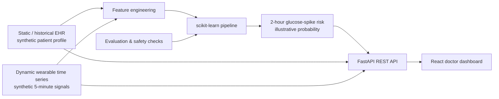

# GlucoTwin — Synthetic Digital Twin for Glucose-Spike Risk

**Happiest Health Digital Twin Challenge 2026 | Individual proof of concept**

GlucoTwin demonstrates how a virtual patient profile can combine historical electronic health record (EHR) features with recent wearable-style time-series signals to estimate the risk of a glucose spike in the next two hours.

> **Safety and scope:** This is an educational prototype using synthetic data. It is not a medical device, diagnostic tool, or clinically validated prediction system. Do not use it for patient care or treatment decisions. All predictions are illustrative and require prospective clinical validation before any real-world use.

## What it demonstrates
- Synthetic longitudinal EHR records: demographics, HbA1c, medication adherence proxy, prior glucose values, and comorbidity indicators.
- Dynamic wearable-style signals: heart rate, HRV proxy, sleep, steps, activity, and current glucose trend.
- A reproducible scikit-learn pipeline trained on synthetic examples.
- FastAPI endpoints for patient summaries, time-series data, risk inference, and model metadata.
- React dashboard for a clinician-facing overview, patient timeline, risk score, and contributing signals.
- Data-generation scripts, tests, architecture, and submission documentation.

## Architecture



## Quick start

### 1. Backend (Python 3.10+)
```bash
cd backend
python -m venv .venv
# Windows PowerShell:
.venv\Scripts\Activate.ps1
# macOS/Linux:
source .venv/bin/activate
pip install -r requirements.txt
python scripts/generate_data.py
python scripts/train_model.py
uvicorn app.main:app --reload
```
API docs: http://127.0.0.1:8000/docs

### 2. Frontend (Node.js 18+)
In a second terminal:
```bash
cd frontend
npm install
npm run dev
```
Open the URL printed by Vite (usually http://localhost:5173).

The frontend expects the API at `http://127.0.0.1:8000`. Set `VITE_API_BASE_URL` if needed. Do not copy `node_modules` from another operating system into the submission; install dependencies on the target machine using `npm install` (or `npm ci` when using the committed lockfile).

## API endpoints
| Method | Endpoint | Purpose |
|---|---|---|
| GET | `/health` | Liveness check |
| GET | `/api/patients` | Synthetic patient list |
| GET | `/api/patients/{patient_id}` | EHR summary and latest wearable values |
| GET | `/api/patients/{patient_id}/timeline` | Recent synthetic time-series |
| POST | `/api/predict` | Estimate illustrative spike risk over the next 2 hours |
| GET | `/api/model-info` | Model metadata and validation caveats |

Example request:
```json
{
  "patient_id": "P-1001",
  "meal_carbs_g": 55,
  "stress_level": 4
}
```

## Model and target definition
The target is a **stochastically generated synthetic label** associated with the next two hours. The data generator samples a sensor window and uses a simulation formula influenced by scenario carbohydrates, recent glucose change, HbA1c, stress, activity, and the simulated future glucose change to generate the label. It is not a directly measured event, a clinically defined spike threshold, or a validated outcome. A Random Forest classifier is trained on features derived from historical EHR-like profiles and recent sensor windows. The API returns a model score, illustrative category, and a feature snapshot. The score is not a calibrated individual medical probability. Holdout metrics on synthetic examples are software sanity checks only and must not be interpreted as real-world accuracy.

## Data and privacy
- All bundled patient and wearable data are synthetic and generated locally.
- No real patient identifiers or clinical records are included.
- Do not upload identifiable health data.
- For real datasets, verify license, permitted use, de-identification, and challenge rules before use.
- Never expose real health data in a public repository.

## Repository layout
```text
backend/
  app/                 FastAPI application, feature/model logic
  data/                Generated synthetic CSV files (created by script)
  models/              Trained model artifact (created by script)
  scripts/             Data generation and model training
  tests/               API smoke tests
frontend/
  src/                 React dashboard
docs/
  architecture.md
  demo_script.md
  presentation_outline.md
  model_card.md
```

## Reproducibility
Run `python scripts/generate_data.py` and then `python scripts/train_model.py` from `backend/`. The random seed is fixed. Generated CSV/model files are reproducible and should be regenerated after changing the data generator or feature logic.

## Open-source license
This project is released under the MIT License. See `LICENSE`.
# Submission Checklist

Fill in before submission:
- Team name: GlucoTwin
- Team leader: Shivam Mishra
- Team size: 1
- College / incubator: Birla Institute of technology Mesra
- Project title: GlucoTwin — Synthetic Digital Twin for Glucose-Spike Risk
- Problem statement: combine historical EHR-like data and dynamic wearable-style signals to estimate a synthetic two-hour glucose-spike event.
- Stack: Python, FastAPI, scikit-learn, pandas, NumPy, React, Vite, Recharts.
- License: MIT
- Public repository URL: https://github.com/SHIVAMS2988GIT/GlucoTwin
- Architecture diagram PDF/PPT: https://drive.google.com/file/d/1ekLdJ2oZYooRwLFXU_SP1UiwMrhVG7tn/view?usp=sharing
- Presentation PDF/PPT: https://docs.google.com/presentation/d/1NMObQB8c5n_E74r4vbsswG3W6U4_ANN1/edit?usp=sharing&ouid=106220844458152638865&rtpof=true&sd=true


## Individual submission checklist
- [ ] Replace team/college details in `docs/submission_checklist.md`
- [ ] Run backend and frontend locally and capture screenshots
- [ ] Run tests and include the output in your final review
- [ ] Review the model card and avoid clinical efficacy claims
- [ ] Create architecture diagram export as PDF/PNG if the portal specifically requires a separate file
- [ ] Record a 20-minute demo and verify its access permissions
- [ ] Push the complete repository to a **public** GitHub repository
- [ ] 
