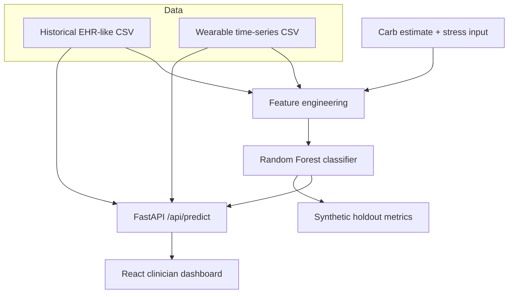

# GlucoTwin Architecture

## System boundaries
The prototype is a local, synthetic-data proof of concept. It is not connected to an EHR vendor, medical device, or real patient record.

## Data flow
1. **Historical EHR-like profile:** age, sex, diabetes duration, HbA1c, adherence proxy, hypertension flag, prior glucose mean.
2. **Wearable-style time series:** simulated glucose, heart rate, HRV, sleep estimate, steps, activity, at five-minute intervals.
3. **Feature engineering:** latest sensor values plus a 30-minute glucose change and scenario inputs.
4. **ML model:** RandomForestClassifier trained on generated synthetic labels.
5. **API:** FastAPI validates inputs and returns a probability, category, horizon, and factor snapshot.
6. **Dashboard:** React displays the patient overview, recent glucose chart, historical profile, scenario controls, and model result.

## Mermaid diagram

## Key implementation decisions
- Fixed random seed for repeatable synthetic data.
- Data generator and model trainer are explicit scripts.
- API returns 404 for unknown patient IDs and 503 when generated assets are missing.
- CORS is limited to local Vite origins by default.
- No authentication is included because the prototype is local and contains no real health information. Any deployment with real or sensitive data requires authentication, authorization, audit logs, encryption, privacy review, and security testing.
